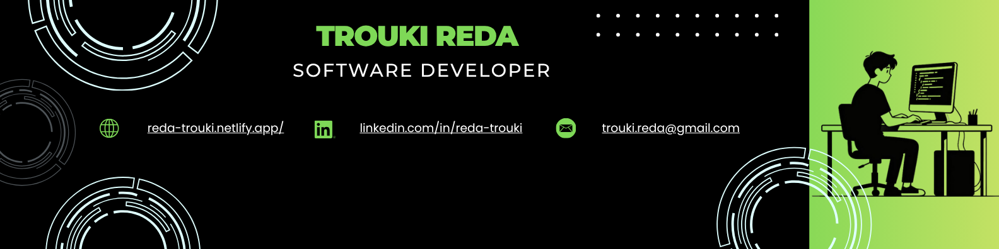
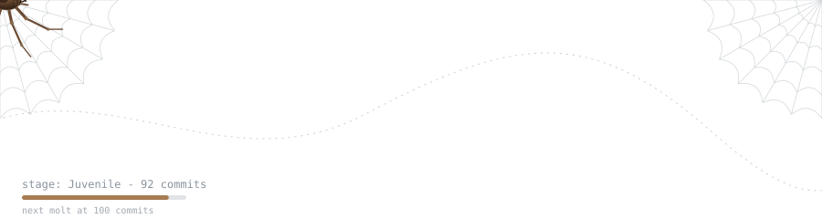
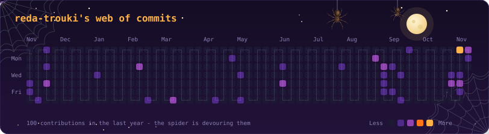
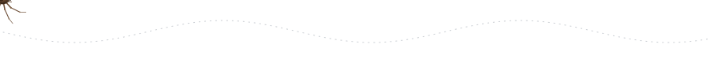
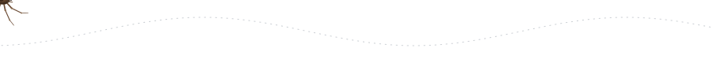
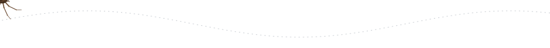

  

<h1 align="center">
  
  Hi there! I'm Trouki Reda
  
</h1>

  

  

  

##  About Me

  

##  Connect with Me

  
  
  

##   Tech Stack

  
  
  
  
  
  
  
  
  
  
  
  
  
  
  
  
  
  
  
  
  
  
  
  
  
  
  
  
  
  
  
  
  
  
  
  
  
  
  
  
  
  
  
  
  
  
  
  
  
  
  
  
  
  
  
  
  
  
  
  
  
  
  
  
  
  
  
  
  
  
  
  
  
  
  
  
  
  
  
  
  
  
  
  
  

## 💭 Random Dev Quote

  

  

  

  <i>🚀 If you can dream it, you can code it! Let's build something amazing together! 💫</i>

  🕸️ The spider above is generated from this repo's commit count. Push more commits and it grows (Spiderling → Juvenile → Subadult → Adult → Giant) 🕷️

